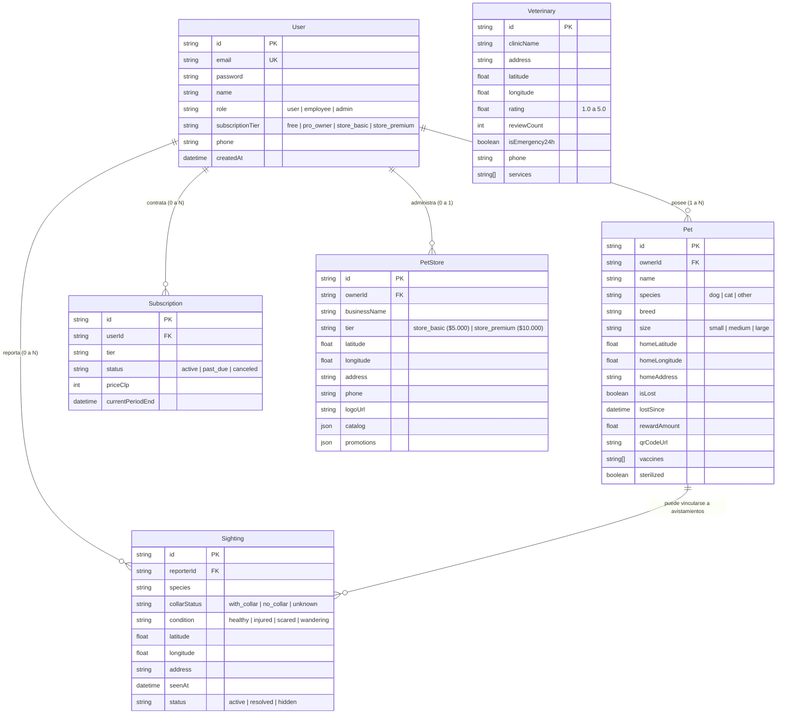

# Modelo de Dominio y Diagrama Entidad-Relación (ERD) — UbicaDog

Este documento define las entidades del dominio, sus invariantes y relaciones según el esquema Prisma en [server/prisma/schema.prisma](../../server/prisma/schema.prisma).

---

## 1. Diagrama Entidad-Relación (Mermaid)

---

## 2. Invariantes del Dominio

1. **Límite Freemium**: Si `User.subscriptionTier === 'free'`, la cantidad de mascotas con `ownerId === User.id` no puede superar **1**.
2. **Ciclo de Pérdida**:
   - Al cambiar `Pet.isLost` de `false` a `true`, `lostSince` se establece en la marca de tiempo actual (`now()`).
   - El radio de búsqueda se calcula mediante la fórmula etológica:
     - Perros: Base de 600m en Día 0, expandiéndose ~1.2 km a 1.5 km diarios ponderado por tamaño (`small: 0.75x`, `medium: 1.0x`, `large: 1.35x`).
     - Gatos: 300m fijos durante las primeras 48h (ocultamiento territorial) y expansión cautelosa posterior.
3. **Planes de Tiendas**:
   - `store_basic` (\$5.000 CLP): Máximo 5 productos en vitrina, sin emisión de cupones de descuento.
   - `store_premium` (\$10.000 CLP): Catálogo ilimitado, halo dorado en mapa y emisión de cupones geolocalizados.
