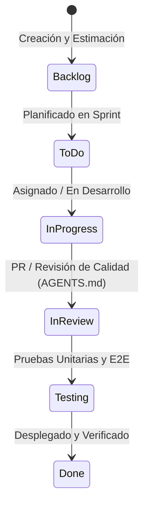

# 🎫 Sistema de Tickets y Flujo de Trabajo Ágil — UbicaDog

Este documento establece el marco de trabajo ágil (*Scrum / Kanban*) para guiar la evolución y el refinamiento progresivo de **UbicaDog**. Cada ticket cuenta con objetivo de negocio, criterios de aceptación (*Acceptance Criteria*), dependencias y definición de terminado (*Definition of Done*).

---

## 🚦 Estados del Flujo de Trabajo

---

## 🗂️ Épica 1: Compartición Remota y Staging (Colaboración con Socios)

### [TICK-101] Acceso Remoto Inmediato para Socios vía Expo Tunnel & Cloudflared
- **Tipo**: DevOps / Habilitación
- **Prioridad**: `P0 (Crítica / Inmediata)`
- **Estimación**: 2 Puntos de Historia
- **Descripción**: Permitir que el socio del proyecto y los testeadores externos abran la aplicación móvil en sus teléfonos (Expo Go) y la web en sus computadoras desde cualquier ubicación física sin depender de la misma red Wi-Fi ni configurar routers.
- **Criterios de Aceptación**:
  - [ ] El comando `npx expo start --tunnel` genera una URL pública `exp://...` accesible desde cualquier red móvil 4G/5G.
  - [ ] El backend API se expone con HTTPS seguro para que la app móvil en terreno pueda consumir endpoints remotos.
  - [ ] Se documenta el procedimiento paso a paso en una guía rápida para socios.
- **Definición de Terminado (DoD)**: El socio escanea el QR desde su domicilio y navega por el mapa interactivo y directorio de veterinarias.

---

### [TICK-102] Despliegue en la Nube de Staging (24/7 sin PC encendida)
- **Tipo**: Infraestructura / Cloud
- **Prioridad**: `P1 (Alta)`
- **Estimación**: 5 Puntos de Historia
- **Descripción**: Alojar el Backend y la Base de Datos en un entorno de pruebas permanente en la nube (Vercel para Frontend, Render/Railway para Backend, Supabase para PostgreSQL + PostGIS).
- **Criterios de Aceptación**:
  - [ ] Instancia de PostgreSQL 16 con extensión `postgis` activa en Supabase / Neon (plan gratuito).
  - [ ] Backend Express desplegado en Render con variables de entorno configuradas (`DATABASE_URL`, `JWT_SECRET`, `CLIENT_URL`).
  - [ ] Frontend Web alojado en Vercel con integración continua (`git push` despliega automáticamente).
- **Definición de Terminado (DoD)**: Enlace `https://ubicadog-staging.vercel.app` operativo los 365 días del año.

---

## 🗂️ Épica 2: Alertas Proactivas y Notificaciones Push Nativas

### [TICK-201] Integración de Notificaciones Push Nativas con Expo Notifications
- **Tipo**: Feature Móvil
- **Prioridad**: `P1 (Alta)`
- **Estimación**: 5 Puntos de Historia
- **Descripción**: Cuando un dueño presiona el botón *"ACTIVAR: MI MASCOTA ESTÁ PERDIDA"*, los teléfonos de los vecinos situados dentro del radio de dispersión deben recibir una notificación push en su barra de estado (incluso con la app cerrada o en segundo plano).
- **Criterios de Aceptación**:
  - [ ] Registro del `ExpoPushToken` de cada usuario en el backend.
  - [ ] Servicio en backend (`server/src/services/pushService.ts`) que filtra tokens de usuarios según su última coordenada conocida dentro del radio.
  - [ ] Envío masivo mediante el servicio oficial de Expo Push API con título, foto de la mascota y recompensa.
- **Definición de Terminado (DoD)**: El teléfono de pruebas recibe la alerta push con sonido de emergencia al activarse una búsqueda vecina.

---

## 🗂️ Épica 3: Resiliencia Offline y Modo en Terreno

### [TICK-301] Caché Local de Reportes en Móvil (Offline-First)
- **Tipo**: Arquitectura Móvil
- **Prioridad**: `P2 (Media)`
- **Estimación**: 5 Puntos de Historia
- **Descripción**: Permitir que un transeúnte que encuentra un perro en una quebrada o cerro sin señal 4G pueda tomar la foto, registrar las señas del collar y guardar el reporte en la memoria local del dispositivo; al detectar conexión a internet, se sincroniza automáticamente con el servidor.
- **Criterios de Aceptación**:
  - [ ] Almacenamiento local mediante AsyncStorage o SQLite en React Native.
  - [ ] Detección del estado de conectividad mediante `@react-native-community/netinfo`.
  - [ ] Cola de sincronización en segundo plano con reintentos exponenciales.
- **Definición de Terminado (DoD)**: Modo avión activado ➔ Se crea reporte ➔ Se desactiva modo avión ➔ El reporte aparece en el mapa del servidor.

---

## 🗂️ Épica 4: Inteligencia Artificial y Detección de Mascotas

### [TICK-401] Comparador Inteligente de Similitud Fotográfica (Vision AI)
- **Tipo**: Innovación / Feature
- **Prioridad**: `P2 (Media)`
- **Estimación**: 8 Puntos de Historia
- **Descripción**: Cuando un usuario sube la foto de una mascota encontrada en la calle, el sistema analiza el color de pelaje, tamaño y raza contra las mascotas perdidas activas en esa comuna y sugiere coincidencias con porcentaje de probabilidad (*"92% de coincidencia con Rocky"*).
- **Criterios de Aceptación**:
  - [ ] Procesamiento de embeddings visuales o llamado a Gemini Vision API en backend.
  - [ ] Ranking de coincidencias ordenado por probabilidad y cercanía geográfica.
  - [ ] Notificación automática al dueño: *"Un vecino avistó una mascota muy similar a la tuya a 800m"*.
- **Definición de Terminado (DoD)**: Prueba con fotos similares devuelve match con enlace directo para contactar al reportero.

---

## 🗂️ Épica 5: Monetización y Webhooks de Stripe

### [TICK-501] Automatización de Webhooks de Stripe Billing
- **Tipo**: Backend / Finanzas
- **Prioridad**: `P1 (Alta)`
- **Estimación**: 3 Puntos de Historia
- **Descripción**: Procesar eventos de ciclo de vida de suscripción (`invoice.payment_succeeded`, `customer.subscription.deleted`) para actualizar automáticamente el campo `subscriptionTier` del usuario de `free` a `pro_owner` o de vuelta a `free` ante impago.
- **Criterios de Aceptación**:
  - [ ] Endpoint seguro `/api/stripe/webhook` con validación de firma criptográfica (`stripe.webhooks.constructEvent`).
  - [ ] Actualización idempotente del estado de la suscripción en la base de datos.
- **Definición de Terminado (DoD)**: Evento simulado desde Stripe CLI degrada el plan inmediatamente y bloquea el registro de una 2ª mascota.
